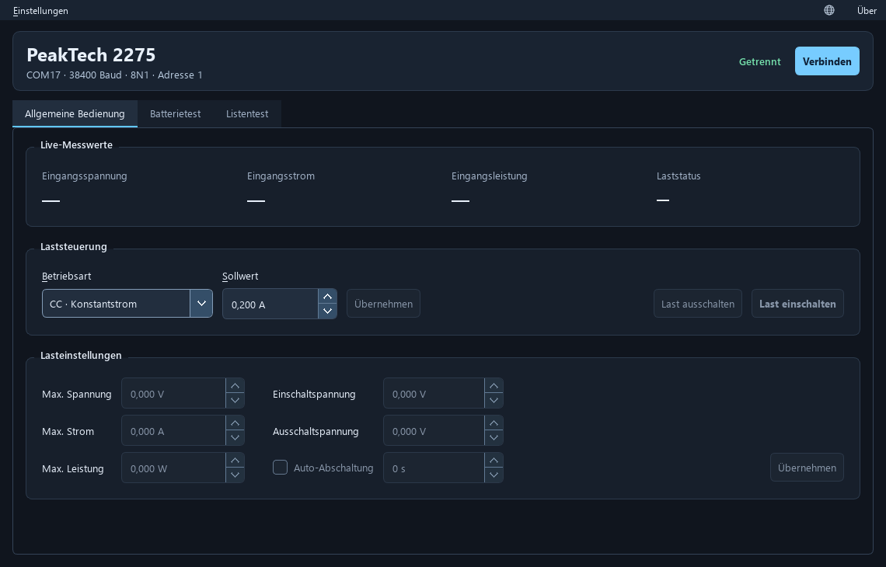

# PeakTech 2275

Windows-Anwendung zur seriellen Steuerung der programmierbaren elektronischen Last PeakTech 2275. Sie zeigt Spannung, Strom und Leistung an und bietet allgemeine Laststeuerung, Batterie- und Listentests.

## Bildschirmaufnahmen

| Hell | Dunkel |
| --- | --- |
|  |  |

## Installation unter Windows

Das [GitHub-Release](https://github.com/GitterRalf/peaktech2275/releases/latest) enthält das 64-Bit-Setup mit Qt- und MinGW-Laufzeitdateien. Der Standardordner ist `C:\Programme\PeakTech 2275`. Zum Download ist ein GitHub-Konto mit Zugriff auf das private Repository erforderlich. Falls ein USB-Seriell-Adapter einen Treiber benötigt, diesen separat installieren.

## Bedienung

- Unter **Einstellungen → Serielle Verbindung** den COM-Port, die Baudrate und die Geräteadresse passend zum Gerät einstellen. Voreinstellung sind **COM17**, **38.400 Baud** und Adresse **1**. Die Schnittstelle arbeitet mit 8 Datenbits, keiner Parität, einem Stoppbit und ohne Flusssteuerung.
- **Verbinden** liest Gerätekennung, Messwerte und Geräteeinstellungen. Unter **Allgemeine Bedienung** stehen die Konstant-Modi CC, CV, CP und CR sowie Sollwert und Lastgrenzen zur Wahl.
- Unter **Batterietest** werden der Entladevorgang und sein Messverlauf angezeigt. **Listentest** dient zum Bearbeiten, Übertragen und Ausführen von Prüfschritten.
- Das Sprachsymbol bietet Deutsch, English und Français. Unter **Einstellungen → Darstellung** stehen Hell und Dunkel zur Wahl. Fensterposition und -größe werden beim nächsten Start wiederhergestellt.
- **Über** zeigt die Version und das animierte OsciViewer-Logo. **Über → Nach Updates suchen** startet die manuelle Prüfung. Für das private Repository muss die GitHub CLI mit einem berechtigten Konto angemeldet sein (`gh auth login`).

## Bauen

Benötigt werden ein 64-Bit-Windows-Kit mit Qt 6 einschließlich Widgets, Network, Serial Port, Charts und Linguist Tools, CMake ab 3.24 und Ninja.

~~~powershell
.\build.ps1
~~~

Das Skript baut `build\PeakTech2275.exe` und stellt die Laufzeit-DLLs bereit. Danach `PeakTech2275.iss` mit Inno Setup kompilieren. Es übernimmt die Version aus `CMakeLists.txt` und das Icon aus `assets/app.rc` und legt die Setupdatei unter `installer` ab.

## Lizenz

Der Projektquellcode und das animierte OsciViewer-Logo stehen unter der [MIT-Lizenz](LICENSE). Für die ausgelieferte Anwendung mit Qt Charts gilt GPLv3. Die [Drittanbieter-Hinweise](THIRD-PARTY-NOTICES.txt) nennen die jeweiligen Lizenztexte und die passenden Quellarchive.
